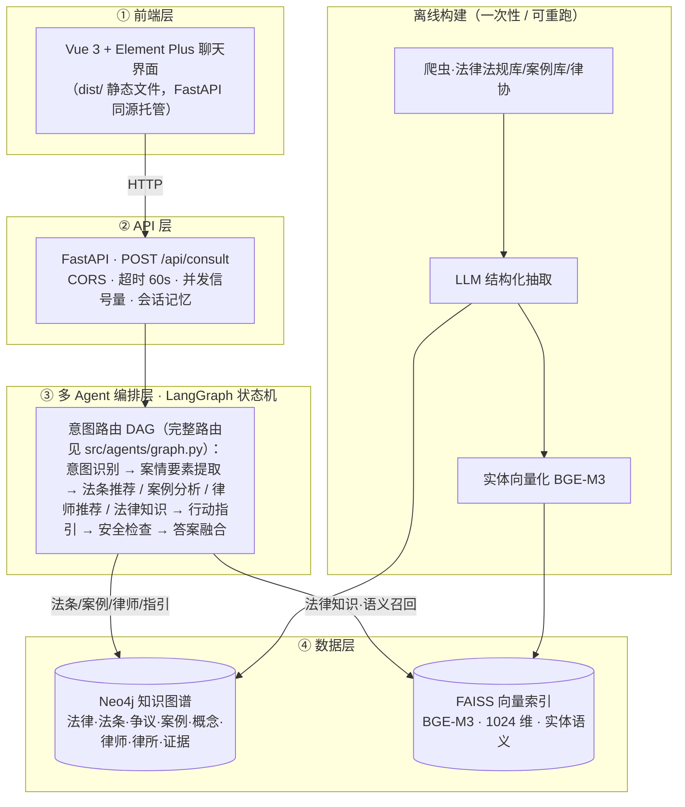

# 智能法律咨询Agent系统 - 技术设计文档 (TDD)

## 0. 工程规范（契约与验收）

> **本章定位**：本 TDD 是 AI 生成器（Claude Code）的**系统约束 + 验收清单**。本章每条规范满足两个条件：
> ① **结构性约束**——违规在写法上就不成立（导入枚举，而非手敲字符串）；
> ② **自动化验收**——每条规范附可执行检查，由 AI 在生成后自行运行（`python scripts/check_contracts.py`）。
>
> **学生用法**：不需要背诵规范。每条 Vibe Coding 指令开头固定写一句——
> 「严格遵守 TDD.md 第 0 章工程规范 R1–R8，生成后运行自检，全绿才算完成」。

### 0.1 为什么需要工程规范（Vibe Coding 的漂移问题）

AI 逐模块生成代码，每个模块内部永远自洽；但同一个名字如果活在多处（Schema 定义 / 抽取提示词 / 建图模板 / 查询语句 / 存量数据），多轮迭代后必然漂移。

**真实事故（原医疗项目）**：关系类型名规范化迁移只改了代码层，存量 Neo4j 数据未迁移（库里仍是 `BELONG_TO_DEPARTMENT`，代码查询 `BELONGS_TO_DEPARTMENT`）→ 科室推荐的图谱查询全部静默返空（日志 `kg=[]` + Neo4j 警告 `relationship type is not in the database`）→ 所有回答退化为纯 LLM 兜底，效果与通用大模型无异。

**规范的定位**：一致性类 bug（名字 / 字段 / 维度 / 数据与代码漂移）恰恰是零基础学生完全无法调试的类别——规范的目标是让这类 bug **在诞生当天死亡**。

### R1 单一事实来源（Single Source of Truth）

**约束**：

1. 节点类型、关系类型**只允许**定义在 `src/knowledge_graph/schema.py` 的 `NodeType` / `RelationType` 枚举中；意图类型只在 `src/agents/state.py` 的 `IntentType`。
2. 其他所有文件（抽取 prompt、建图模板、查询方法、Cypher 拼装）一律 **import 枚举**后用 `.value` 拼装，**禁止直接书写类型名字符串**。
3. 可调参数（阈值 / 超时 / top_k / 端口）一律进 `config/settings.py`，禁止散落魔法数字。

**法律版契约枚举（唯一权威定义）**：

```python
# src/knowledge_graph/schema.py
class NodeType(str, Enum):
    LAW = "Law"                # 法律/法规
    CLAUSE = "Clause"          # 法条
    LEGAL_ISSUE = "LegalIssue" # 法律争议/纠纷类型
    CASE = "Case"              # 案例
    LEGAL_CONCEPT = "LegalConcept"  # 法律概念
    LAWYER = "Lawyer"          # 律师
    LAW_FIRM = "LawFirm"       # 律所
    EVIDENCE = "Evidence"      # 证据类型

class RelationType(str, Enum):
    CONTAINS = "CONTAINS"              # (Law)-[:CONTAINS]->(Clause) 法律包含法条
    REGULATES = "REGULATES"            # (Clause)-[:REGULATES]->(LegalIssue) 法条规制争议
    INVOLVES = "INVOLVES"              # (Case)-[:INVOLVES]->(LegalIssue) 案例涉及争议
    CITES = "CITES"                    # (Case)-[:CITES]->(Clause) 案例引用法条
    SPECIALIZES_IN = "SPECIALIZES_IN"  # (Lawyer)-[:SPECIALIZES_IN]->(LegalIssue) 律师擅长争议
    EMPLOYS = "EMPLOYS"                # (LawFirm)-[:EMPLOYS]->(Lawyer) 律所雇用律师
    NEEDS_EVIDENCE = "NEEDS_EVIDENCE"  # (LegalIssue)-[:NEEDS_EVIDENCE]->(Evidence) 争议需证据
    DEFINES = "DEFINES"                # (Clause)-[:DEFINES]->(LegalConcept) 法条定义概念
    RELATED_TO = "RELATED_TO"          # (LegalIssue)-[:RELATED_TO]->(LegalIssue) 争议相关
    APPLIES = "APPLIES"                # (Case)-[:APPLIES]->(Law) 案例适用法律
```

```python
# src/agents/state.py
class IntentType(str, Enum):
    LAW = "law"          # 法条推荐
    CASE = "case"        # 案例分析
    LAWYER = "lawyer"    # 律师推荐
    KNOWLEDGE = "knowledge"  # 法律知识
    GENERAL = "general"  # 其他/闲聊
```

**验收**：

```bash
python scripts/check_contracts.py --r1
# 1) 历史错误名扫描：BELONG_TO_DEPARTMENT / TREATED_BY_DRUG / HAS_SYMPTOM 等医疗旧名出现即报错
# 2) 枚举定义位置检查：除 schema.py / state.py 外不允许出现 Enum 类型定义
# 3) 未知名字扫描：代码中出现枚举之外的 SCREAMING_SNAKE 类型名 → 告警
```

### R2 契约先行与生成顺序

**约束**：模块必须按契约依赖顺序生成，下游生成时**先 import 已存在的契约文件**，不允许引入契约之外的新类型名 / 字段名；确需扩展时，**先改契约文件，再重新生成下游**。

```
schema.py（名字契约）→ extraction/（抽取，产出契约内类型）→ graph_builder（按契约写库）
→ graph_queries（按契约读库）→ vector_store（索引字段契约）→ agents/ → api/（接口契约）→ frontend/
```

**验收**：R1 + R5 检查全绿（见下）。

### R3 前后端字段契约

**约束**：接口字段**只在 `src/api/models.py` 实现**；前端按契约表逐字段消费；字段增删改必须**先更新本表**再动代码。

**契约表（本项目现行）**：

| 接口 / 通道                             | 字段              | 类型             | 生产方                 | 前端消费位置         |
| --------------------------------------- | ----------------- | ---------------- | ---------------------- | -------------------- |
| POST /api/consult 请求                  | query             | str              | 前端输入               | —                   |
|                                         | session_id        | str              | 前端生成               | —                   |
| /api/consult 响应（也是 SSE answer 帧） | answer            | str              | answer_fusion          | ChatMessage 正文     |
|                                         | intent            | str              | intent_classifier      | 元信息意图标签       |
|                                         | issue_types       | list[str]        | fact_detector          | 争议类型 el-tag      |
|                                         | laws              | list[dict]       | law_recommender        | 法条 el-tag          |
|                                         | cases             | list[dict]       | case_analyzer          | 案例 el-tag          |
|                                         | lawyers           | list[dict]       | lawyer_recommender     | 律师 el-tag          |
|                                         | disclaimers       | list[str]        | safety_checker（强制） | 黄色免责块           |
|                                         | warnings          | list[str]        | safety_checker         | 红色紧急 alert       |
|                                         | linked_entities   | list[dict]       | legal_knowledge 实体链接 | 「知识定位」标签   |
|                                         | duration_ms       | int              | API 层                 | 元信息耗时           |
| SSE progress 帧                         | node / label / facts | str / str / dict | routes（NODE_LABELS_ZH） | ChatMessage 进度轨迹 |
| SSE error 帧                            | message           | str              | routes                 | 前端错误提示         |
| GET /api/health                         | status / neo4j_connected / vector_index_loaded / agent_system_ready | str / bool×3 | AppState | 侧栏状态灯 |
| GET /api/stats                          | knowledge_graph / vector_index / api | dict×3          | 各数据源               | （预留）             |

**验收**：

```bash
python scripts/check_contracts.py --r3
# 前端 data.<字段> 引用了 models.py 不存在的字段 → 错误
# models.py 提供但前端从未消费的字段 → 告警（如新增字段忘了接）
```

### R4 索引与嵌入契约

**约束（数值契约，改动须同步本表）**：

| 契约项                 | 值                                  | 权威位置                                                                                      |
| ---------------------- | ----------------------------------- | --------------------------------------------------------------------------------------------- |
| 嵌入模型               | BGE-M3                              | `models/bge-m3`，`settings.embedding_model_path`                                          |
| 向量维度               | **1024**                      | `models/bge-m3/config.json` 的 `hidden_size`；`scripts/build_index.py` 的 `dimension` |
| 索引类型               | IndexIVFFlat + METRIC_INNER_PRODUCT | `scripts/build_index.py`（向量必须 `normalize_embeddings=True`）                          |
| entities.json 条目结构 | `{name, type, data}`              | `data/indexes/entities.json`，下标与索引向量一一对应                                        |
| 相似度换算             | IP→原值；L2→`1 - d/2`           | `VectorRetriever._distance_to_similarity`                                                   |

**验收**：

```bash
python scripts/check_contracts.py --r4
# 断言：index.d == 1024 == config.json hidden_size；len(entities.json) == index.ntotal；条目键齐全
```

### R5 数据即产物（Rebuild over Migration）

**约束**：Neo4j 图内容、FAISS 索引、`data/` 下全部 JSON 均声明为**代码的构建产物**。任何契约变更（R1–R4 涉及的名字 / 字段 / 维度改动）的修复流程**固定为**：

```bash
# 改完契约文件后：
python -m src.knowledge_graph.graph_builder clear     # 清空
python -m src.knowledge_graph.graph_builder build     # 重建（MERGE 幂等）
python scripts/build_index.py                         # 索引随之重建
```

**禁止**编写"兼容旧数据"的迁移 / 修补脚本（教学阶段）——学生只需理解"代码对了就重跑"，不需要理解新旧状态共存。

**验收**：

```bash
python scripts/check_contracts.py --r5
# DB 节点标签 ⊆ NodeType（法律项目无辅助抽取例外类型，全部契约内）
# DB 关系类型 ⊆ RelationType；出现枚举之外的类型 = 错误（报错信息附 clear+build 修复指令）
# 缺失的类型 = 告警（子集属正常，由抽取数据覆盖范围决定）
```

### R6 命名公约与单向关系

**约束**：

1. 关系名采用 `动词_宾语` 大写蛇形：`CONTAINS`、`REGULATES`、`SPECIALIZES_IN`、`NEEDS_EVIDENCE`。
2. **一个事实只用一个方向表达**；反向语义用 Cypher 反向遍历表达（如"争议找法条"用 `MATCH (c:Clause)-[:REGULATES]->(i:LegalIssue)` 反向匹配），不为同一事实新建反向关系类型——关系数量减半即漂移面减半。
3. **本项目为全新项目，无历史例外**：所有关系一律遵守单向原则，不保留任何反向关系类型。

### R7 模块自检条款

**约束**：TDD 各模块小节末尾必须附「生成后必跑」检查清单；AI 生成后**立即自行运行**，不绿则停下报告，不交付半成品。

**统一验收器**：`scripts/check_contracts.py`（覆盖 R1 / R3 / R4 / R5），退出码 0 = 全绿。

| 模块                                              | 生成后必跑                                            |
| ------------------------------------------------- | ----------------------------------------------------- |
| `src/extraction/`                               | `check_contracts.py --r1`；抽取产物类型集合 ⊆ 枚举 |
| `src/knowledge_graph/`                          | `check_contracts.py --r1 --r5`                      |
| `src/vector_store/`、`scripts/build_index.py` | `check_contracts.py --r4`                           |
| `src/api/`、`frontend/`                       | `check_contracts.py --r3` + `npm run build`       |
| 全模块完成后                                      | R8 黄金冒烟                                           |

### R8 黄金冒烟（端到端验收）

每完成一个模块，重跑以下命令，全绿方可继续：

```bash
python scripts/check_contracts.py              # 契约门禁（R1/R3/R4/R5）
python scripts/integration_test.py             # 四端点冒烟（health/stats/consult/consult-stream SSE 帧序）
python evals/runner.py --limit 10              # 评估门禁：disclaimer=1.0、紧急事项召回、intent≥0.9
```

### 0.2 课堂操作流程（零基础视角）

```
1. 每条 Vibe Coding 指令开头：「严格遵守 TDD.md 第 0 章工程规范 R1–R8，生成后运行自检」
2. AI 生成模块 → AI 自己跑 check_contracts.py → 红了自己修（学生旁观即可）
3. 涉及数据的红色错误 → 修复口径只有 clear + build（R5），不写迁移补丁
4. 课末学生跑 R8 黄金冒烟 → 绿勾 → 下课
```

### 0.3 规范的边界（诚实声明）

R1–R8 只能消除**一致性类** bug（名字 / 字段 / 维度 / 数据与代码漂移）；**消除不了**逻辑 / 提示词 / 数据质量类 bug——后者交给 day04 的评估驱动迭代（`evals/`）。区别在于：一致性 bug 学生完全无法调试，必须在设计期消灭；逻辑类 bug 学生"看得见"（答案不好），是可以参与调试的教学素材。

---

## 1. 技术架构

### 1.1 整体架构

系统分为**在线服务**与**离线构建**两条链路。在线：前端 → API → 多 Agent 编排 → 数据层；离线：爬虫 → LLM 抽取 → 建图 / 向量索引（一次性、可重跑，在线只读）。



**各 Agent 的数据访问（哪个 Agent 查哪个库、用什么机制）**：

| Agent                          | 机制                                   | Neo4j | FAISS | 说明                                                                 |
| ------------------------------ | -------------------------------------- | :---: | :---: | -------------------------------------------------------------------- |
| 意图识别 intent_classifier     | 纯 LLM                                 |  —  |  —  | 五分类（law / case / lawyer / knowledge / general）                |
| 案情要素提取 fact_detector     | 纯 LLM                                 |  —  |  —  | 抽取争议类型、主体、关键事实；信息不足可置`needs_clarification`；识别紧急事项 |
| 法条推荐 law_recommender       | 确定性 LLM+图检索                      |  ✅  |  —  | Tier1 图谱（争议→法条）→ Tier2 LLM 兜底                            |
| 案例分析 case_analyzer         | 确定性 LLM+图检索                      |  ✅  |  —  | 争议→案例 + 法条→裁判要点分析                                      |
| 律师推荐 lawyer_recommender    | 确定性 LLM+图检索                      |  ✅  |  —  | 争议→律师/律所                                                     |
| 法律知识 legal_knowledge       | **强制混合检索 + grounded 生成** |  ✅  |  ✅  | FAISS 语义召回→Neo4j 取事实；检索为空时分风险兜底                   |
| 行动指引 action_advisor        | 确定性 LLM+图检索                      |  ✅  |  —  | 争议→证据类型/维权步骤；取图谱上下文生成指引                        |
| 安全检查 safety_checker        | 纯规则                                 |  —  |  —  | 免责声明 / 紧急法律事项升级（不依赖 LLM）                           |
| 答案融合 answer_fusion         | 纯 LLM                                 |  —  |  —  | 汇总各 Agent 输出 + 追问话术                                        |
| 通用对话 general_chat          | 纯 LLM                                 |  —  |  —  | 非法律闲聊                                                            |

> **机制选型**：检索模式固定的 Agent（法条/案例/律师/指引）用**确定性 LLM+图检索**（快、省、可审计）；只有问法开放、可能多跳的**法律知识**分支用 FAISS+Neo4j **混合检索**，且检索为**强制必经**——法律场景要求答案可溯源、有法条依据，不允许模型跳过检索凭空作答。

### 1.2 架构说明

**分层设计**：

1. **用户界面层**：Vue 3 + Element Plus 聊天应用，负责用户交互
2. **API 服务层**：FastAPI REST API，负责请求路由和参数校验
3. **Agent 系统层**：LangGraph 多 Agent 编排，负责业务逻辑
4. **数据访问层**：Neo4j 知识图谱 + FAISS 向量索引，负责数据存储和检索

**设计原则**：

- 前后端分离：Vue 前端通过 HTTP 调用 FastAPI（生产模式前端构建为静态文件由 FastAPI 同源托管）
- 模块化设计：每个 Agent 职责单一，易于测试和维护
- 可扩展性：新增 Agent 不影响现有系统
- 安全性：所有法律建议强制添加免责声明
- 可溯源（强制检索）：法律知识问答**必须先检索知识库再作答**；检索为空时诚实兜底——一般知识标注"非本系统知识库内容"，涉及诉讼时效/刑事责任等高风险建议直接咨询律师，杜绝幻觉
- 确定性优先：检索模式固定的环节用确定性流水线，仅在开放问答分支引入 Agent 式工具调用，**不滥用 ReAct**（以确定性/可审计性换取不必要的"自主性"是反模式）
- 在线/离线分离：图谱与向量索引由离线流水线构建（可重跑），在线服务只读，互不耦合
- 数据访问最小化：每个 Agent 只访问其必需的存储（仅法律知识同时用 FAISS+Neo4j），降低耦合与噪声

### 1.3 部署架构

**推荐方式：docker-compose 启动 Neo4j**（声明式、可复现、纳入版本控制）：

```bash
# 1. 启动 Neo4j（项目根目录已提供 docker-compose.yml）
docker-compose up -d

# 2. 构建前端（首次或前端改动后）
cd frontend && npm run build

# 3. 启动 FastAPI（同时托管 API + 前端静态文件，单进程）
python scripts/start_api.py
# 访问 http://localhost:8000 即是完整应用

# 开发模式（可选，前端热更新）：另开终端运行 cd frontend && npm run dev，访问 http://localhost:5173
```

**快速参考：docker run 单命令启动**（等价于上面的 compose，适合临时使用）：

```bash
docker run -d --name neo4j \
  -p 7474:7474 -p 7687:7687 \
  -e NEO4J_AUTH=neo4j/12345678 \
  -v neo4j_data:/data \
  neo4j:5.26
```

> **说明**：本项目采用单进程部署 —— FastAPI 同时托管 API 与 Vue 前端静态文件，因此唯一需要容器化的基础设施是 Neo4j。`docker-compose.yml` 中 Neo4j 使用 `external` 命名卷 `neo4j_data`，与 `docker run` 创建的卷同名，数据可无缝保留。

---

## 2. 模块设计

### 2.1 项目结构

```
legal-consultation-assistant/
├── README.md                          # 项目说明
├── PRD.md                             # 产品需求文档
├── TDD.md                             # 技术设计文档
├── .env                               # 环境变量配置
├── .gitignore                         # Git 忽略文件
├── requirements.txt                   # Python 依赖
│
├── config/                            # 配置文件
│   ├── __init__.py
│   ├── settings.py                    # 全局配置（从 .env 读取）
│   └── paths.py                       # 路径配置（项目目录结构）
│
├── crawler/                           # 数据采集模块（独立数据管道）
│   ├── __init__.py
│   ├── law_crawler.py                 # 法律法规爬虫（国家法律法规数据库等）
│   ├── case_crawler.py                # 案例数据爬虫
│   ├── lawyer_crawler.py              # 律师/律所信息爬虫
│   ├── data_processor.py              # 数据清洗与处理（去重、格式化、统计）
│   └── README.md                      # 爬虫使用说明
│
├── src/                               # 源代码目录（应用核心）
│   ├── __init__.py
│   │
│   ├── common/                        # 公共模块
│   │   ├── __init__.py
│   │   ├── logger.py                  # 统一日志配置（文件+控制台）
│   │   ├── llm.py                     # LLM 客户端封装
│   │   ├── neo4j_client.py            # Neo4j 数据库客户端（单例）
│   │   ├── embedding_model.py         # 向量嵌入模型（单例）
│   │   └── utils.py                   # 通用工具函数
│   │
│   ├── extraction/                    # 实体关系抽取模块
│   │   ├── __init__.py
│   │   ├── schemas.py                 # Pydantic 模型定义
│   │   ├── law_extractor.py           # 法律/法规实体抽取
│   │   ├── clause_extractor.py        # 法条实体抽取
│   │   ├── issue_extractor.py         # 法律争议类型抽取
│   │   ├── case_extractor.py          # 案例实体抽取
│   │   └── lawyer_extractor.py        # 律师/律所实体抽取
│   │
│   ├── knowledge_graph/               # 知识图谱模块
│   │   ├── __init__.py
│   │   ├── schema.py                  # Neo4j Schema 定义（NodeType/RelationType 枚举）
│   │   ├── graph_builder.py           # 图谱构建（MERGE 幂等操作）
│   │   ├── graph_validator.py         # 图谱验证（孤立节点检测）
│   │   └── graph_queries.py           # 图谱查询封装
│   │
│   ├── agents/                        # 多 Agent 系统模块（扁平结构）
│   │   ├── __init__.py
│   │   ├── state.py                   # Agent 状态定义（TypedDict + IntentType）
│   │   ├── graph.py                   # LangGraph 编排（状态图）
│   │   ├── base_agent.py              # Agent 基类
│   │   ├── intent_classifier.py       # 意图识别 Agent
│   │   ├── fact_detector.py           # 案情要素提取 Agent
│   │   ├── law_recommender.py         # 法条推荐 Agent
│   │   ├── case_analyzer.py           # 案例分析 Agent
│   │   ├── lawyer_recommender.py      # 律师推荐 Agent
│   │   ├── legal_knowledge.py         # 法律知识 Agent
│   │   ├── action_advisor.py          # 行动指引 Agent
│   │   ├── safety_checker.py          # 安全检查 Agent
│   │   ├── answer_fusion.py           # 答案融合 Agent
│   │   └── general_chat.py            # 通用对话 Agent
│   │
│   ├── vector_store/                  # 向量检索模块
│   │   ├── __init__.py
│   │   ├── vector_store.py            # 向量存储（FAISS）
│   │   ├── index_builder.py           # 索引构建
│   │   └── search.py                  # 搜索功能
│   │
│   └── api/                           # API 服务模块（扁平结构）
│       ├── __init__.py
│       ├── main.py                    # FastAPI 应用入口（含前端静态文件托管）
│       ├── routes.py                  # API 路由（咨询/健康检查/统计）
│       └── models.py                  # 请求/响应 Pydantic 模型
│
├── frontend/                          # 前端模块（Vue 3 + Element Plus 独立项目）
│   ├── index.html                     # 入口 HTML
│   ├── package.json                   # 依赖与脚本配置
│   ├── vite.config.js                 # Vite 构建配置（含 /api 代理）
│   ├── src/
│   │   ├── main.js                    # 应用入口（挂载 Element Plus）
│   │   ├── App.vue                    # 根组件
│   │   ├── api/index.js               # axios 封装（调用 FastAPI）
│   │   ├── views/ChatView.vue         # 聊天主界面
│   │   └── components/                # 组件（消息气泡、免责声明横幅）
│   └── dist/                          # npm run build 产物（静态文件，由 FastAPI 托管）
│
├── data/                              # 数据目录
│   ├── raw/                           # 原始数据（爬虫输出）
│   │   ├── laws.json                  # 爬取的原始法律/法条数据
│   │   ├── cases.json                 # 爬取的原始案例数据
│   │   └── .crawl_checkpoint.json     # 断点续爬记录
│   ├── processed/                     # 处理后的数据（清洗后）
│   │   ├── laws.json                  # JSON 格式（程序使用）
│   │   └── laws.xlsx                  # Excel 格式（人工查看）
│   ├── knowledge_graph/               # 知识图谱中间数据
│   │   ├── entities.json              # 抽取的实体列表
│   │   ├── relations.json             # 抽取的关系列表
│   │   └── .extraction_checkpoint.json # 抽取断点记录
│   └── indexes/                       # FAISS 索引
│       ├── faiss.index                # 向量索引文件
│       └── entities.json              # 实体元数据
│
├── models/                            # 本地模型文件
│   └── bge-m3/                        # BGE-M3 嵌入模型
│
├── logs/                              # 日志目录
│   ├── crawler.log                    # 爬虫日志
│   ├── extraction.log                 # 实体抽取日志
│   ├── graph_builder.log              # 图谱构建日志
│   └── api.log                        # API 服务日志
│
├── scripts/                           # 脚本目录（入口点）
│   ├── run_crawler.py                 # 运行爬虫
│   ├── run_extraction.py              # 运行实体抽取
│   ├── build_graph.py                 # 构建知识图谱
│   ├── build_index.py                 # 构建向量索引
│   ├── start_api.py                   # 启动 API 服务（同时托管前端静态文件）
│   └── validate_environment.py        # 环境验证
│
└── tests/                             # 测试目录
    ├── unit/                          # 单元测试
    │   ├── test_crawler.py
    │   ├── test_extractor.py
    │   └── test_agents.py
    └── integration/                   # 集成测试
        ├── test_graph_builder.py
        └── test_api.py
```

### 2.2 项目结构设计说明

#### 2.2.1 为什么爬虫模块在根目录？

**设计决策**：`crawler/` 放在项目根目录，而不是 `src/crawler/`

**原因**：

1. **职责分离**：爬虫是**数据管道工具**，不是应用的一部分
2. **运行独立性**：爬虫可以单独运行，无需启动整个应用
3. **符合数据工程实践**：数据采集通常与数据处理、模型训练分离

#### 2.2.2 为什么需要统一日志模块？

**设计决策**：添加 `src/common/logger.py` 统一日志配置

**原因**：避免重复配置、集中管理日志、多输出目标（文件+控制台）、日志轮转。

#### 2.2.3 为什么用 data_processor.py 而不是 data_parser.py？

**设计决策**：使用 `data_processor.py`

**原因**：`processor`（处理器）比 `parser`（解析器）范围更广，包含清洗、去重、格式化、验证；`parser` 仅表示格式转换。

#### 2.2.4 为什么需要 config/paths.py？

**设计决策**：添加 `config/paths.py` 集中管理路径配置

**原因**：避免硬编码、跨平台兼容（pathlib.Path）、易于测试。

### 2.3 核心模块详细说明

#### 模块 1：公共模块 (`src/common/`)

**职责**：提供全局共享的基础功能

**核心类**（与原医疗项目一致，仅项目名变化）：

```python
# config/settings.py
from pydantic_settings import BaseSettings

class Settings(BaseSettings):
    """全局配置类"""
    # LLM 配置
    model_base_url: str
    model_api_key: str
    model_name: str
    # Neo4j 配置
    neo4j_uri: str
    neo4j_user: str
    neo4j_password: str
    # 嵌入模型配置
    embedding_model_path: str
    # 日志配置
    log_level: str = "INFO"

    class Config:
        env_file = ".env"

settings = Settings()
```

```python
# common/llm.py
from langchain_openai import ChatOpenAI
from config.settings import settings

def get_llm() -> ChatOpenAI:
    """获取 LLM 客户端"""
    return ChatOpenAI(
        api_key=settings.model_api_key,
        base_url=settings.model_base_url,
        model=settings.model_name,
        temperature=0.7
    )
```

**生成后必跑**：`python scripts/check_contracts.py --r1`

---

#### 模块 2：数据采集模块 (`crawler/`)

**职责**：从法律数据源采集原始数据，并进行清洗处理

**核心类**：

```python
# crawler/law_crawler.py
import requests
from bs4 import BeautifulSoup
from tenacity import retry, stop_after_attempt, wait_exponential

class LawCrawler:
    """法律法规爬虫（国家法律法规数据库等公开数据源）"""

    def __init__(self):
        self.session = requests.Session()
        self.laws = []

    @retry(stop=stop_after_attempt(3), wait=wait_exponential(multiplier=1, min=2, max=10))
    def _fetch(self, url: str) -> str:
        """获取网页内容（带重试机制）"""
        response = self.session.get(url, timeout=15)
        response.raise_for_status()
        return response.text

    def crawl_law_list(self) -> list[dict]:
        """爬取法律列表（标题、效力级别、发布机构）"""
        # 数据源示例：国家法律法规数据库 https://flk.npc.gov.cn
        pass

    def crawl_law_detail(self, url: str) -> dict:
        """爬取法律详情（含法条正文）"""
        html = self._fetch(url)
        soup = BeautifulSoup(html, "html.parser")
        law = {
            "name": "",              # 法律名称，如"中华人民共和国劳动合同法"
            "level": "",             # 效力级别：法律/行政法规/司法解释/地方法规
            "publish_date": "",      # 发布日期
            "effective_date": "",    # 施行日期
            "clauses": [],           # 法条列表
            "source": "flk.npc.gov.cn",
            "url": url
        }
        # 解析详情页，提取各字段
        return law

    def run(self, max_laws: int = 100):
        """运行爬虫"""
        # 1. 爬取法律列表
        # 2. 逐个爬取法律详情（法条）
        # 3. 保存结果到 data/raw/laws.json
        pass
```

**数据格式**：

```json
{
  "name": "中华人民共和国劳动合同法",
  "level": "法律",
  "publish_date": "2007-06-29",
  "effective_date": "2008-01-01",
  "clauses": [
    {
      "clause_no": "第三十条",
      "content": "用人单位应当按照劳动合同约定和国家规定，向劳动者及时足额支付劳动报酬。"
    }
  ],
  "source": "flk.npc.gov.cn",
  "url": "https://flk.npc.gov.cn/...",
  "crawled_at": "2026-09-01T10:30:00"
}
```

**使用方法**：

```bash
# 1. 运行爬虫（法律法规 + 案例 + 律师信息）
python crawler/law_crawler.py
python crawler/case_crawler.py
python crawler/lawyer_crawler.py

# 2. 清洗数据
python crawler/data_processor.py

# 3. 查看结果
# data/processed/laws.json  (JSON 格式，程序使用)
# data/processed/laws.xlsx  (Excel 格式，人工查看)
```

**生成后必跑**：`python scripts/check_contracts.py --r1`

---

#### 模块 3：实体关系抽取模块 (`src/extraction/`)

**职责**：使用 LLM 从原始文本中提取结构化实体和关系

**核心类**：

```python
# extraction/schemas.py
from pydantic import BaseModel, Field
from typing import List

class LawEntity(BaseModel):
    """法律/法规实体"""
    name: str = Field(description="法律名称")
    level: str = Field(description="效力级别")
    clauses: List[dict] = Field(description="法条列表")

class LegalIssueEntity(BaseModel):
    """法律争议类型实体"""
    name: str = Field(description="争议类型，如'拖欠工资'")
    description: str = Field(description="争议描述")
    related_laws: List[str] = Field(description="相关法律名称")
    related_clauses: List[str] = Field(description="相关法条编号")

class CaseEntity(BaseModel):
    """案例实体"""
    title: str = Field(description="案例标题")
    summary: str = Field(description="案情摘要")
    court: str = Field(description="审理法院")
    judgment: str = Field(description="裁判结果")
    issue_types: List[str] = Field(description="涉及的争议类型")
    cited_clauses: List[str] = Field(description="引用的法条")
    applied_laws: List[str] = Field(description="适用的法律")
```

```python
# extraction/issue_extractor.py
from langchain.prompts import ChatPromptTemplate
from langchain.output_parsers import PydanticOutputParser
from src.common.llm import get_llm
from src.extraction.schemas import LegalIssueEntity

class IssueExtractor:
    """法律争议类型抽取器"""

    def __init__(self):
        self.llm = get_llm()
        self.parser = PydanticOutputParser(pydantic_object=LegalIssueEntity)
        self.prompt = ChatPromptTemplate.from_messages([
            ("system", """你是一个法律信息抽取专家。请从以下文本中提取法律争议信息，并按照指定格式输出。

输出格式：
{format_instructions}

要求：
1. 争议类型使用规范法律术语（如"拖欠工资"而非"公司不给钱"）
2. 相关法条需标准编号（如"《劳动合同法》第三十条"）
3. 如果没有相关信息，对应字段返回空列表"""),
            ("user", "{text}")
        ])

    def extract(self, text: str) -> LegalIssueEntity:
        """从文本中抽取法律争议实体"""
        formatted_prompt = self.prompt.format(
            text=text,
            format_instructions=self.parser.get_format_instructions()
        )
        response = self.llm.invoke(formatted_prompt)
        return self.parser.parse(response.content)
```

**生成后必跑**：`python scripts/check_contracts.py --r1`；抽取产物类型集合 ⊆ 枚举

---

#### 模块 4：知识图谱模块 (`src/knowledge_graph/`)

**职责**：将结构化数据导入 Neo4j，构建法律知识图谱

**Neo4j Schema 设计**：

**节点类型（8 种）**：

```cypher
// 法律/法规节点
(l:Law {
    name: "中华人民共和国劳动合同法",
    level: "法律",
    publish_date: "2007-06-29",
    effective_date: "2008-01-01"
})

// 法条节点
(c:Clause {
    name: "劳动合同法 第三十条",
    content: "用人单位应当按照劳动合同约定和国家规定，向劳动者及时足额支付劳动报酬。"
})

// 法律争议类型节点
(i:LegalIssue {
    name: "拖欠工资",
    description: "用人单位未按时足额支付劳动者劳动报酬"
})

// 案例节点
(cs:Case {
    name: "张某诉某公司追索劳动报酬纠纷案",
    summary: "公司拖欠三个月工资，劳动者申请劳动仲裁...",
    court: "某市中级人民法院",
    judgment: "判决公司支付拖欠工资及经济补偿"
})

// 法律概念节点
(lc:LegalConcept {
    name: "诉讼时效",
    definition: "权利人在法定期间内不行使权利，期间届满后义务人获得抗辩权的制度"
})

// 律师节点
(ly:Lawyer {
    name: "张律师",
    specialty: "劳动人事争议",
    experience: "10年执业经验"
})

// 律所节点
(lf:LawFirm {
    name: "某律师事务所",
    city: "北京",
    description: "专注劳动人事领域"
})

// 证据类型节点
(ev:Evidence {
    name: "劳动合同",
    description: "证明劳动关系的书面凭证"
})
```

**关系类型（10 种）**：

```cypher
// 法律-法条关系
(l:Law)-[:CONTAINS]->(c:Clause)

// 法条-争议关系（法条规制某类争议）
(c:Clause)-[:REGULATES {relevance: "direct"}]->(i:LegalIssue)

// 案例-争议关系
(cs:Case)-[:INVOLVES]->(i:LegalIssue)

// 案例-法条关系（案例引用法条）
(cs:Case)-[:CITES]->(c:Clause)

// 律师-争议关系（律师擅长领域）
(ly:Lawyer)-[:SPECIALIZES_IN]->(i:LegalIssue)

// 律所-律师关系
(lf:LawFirm)-[:EMPLOYS]->(ly:Lawyer)

// 争议-证据关系
(i:LegalIssue)-[:NEEDS_EVIDENCE {importance: "required"}]->(ev:Evidence)

// 法条-概念关系（法条定义概念）
(c:Clause)-[:DEFINES]->(lc:LegalConcept)

// 争议-争议关系
(i1:LegalIssue)-[:RELATED_TO {relation_type: "similar"}]->(i2:LegalIssue)

// 案例-法律关系（案例适用法律）
(cs:Case)-[:APPLIES]->(l:Law)
```

**核心类**：

```python
# knowledge_graph/graph_builder.py
from src.common.neo4j_client import neo4j_client
from src.knowledge_graph.schema import NodeType, RelationType

class GraphBuilder:
    """知识图谱构建器"""

    def create_indexes(self):
        """创建索引，加速查询"""
        for node_type in NodeType:
            label = node_type.value
            neo4j_client.run(f"CREATE INDEX IF NOT EXISTS FOR (n:{label}) ON (n.name)")

    def merge_law_node(self, law_data: dict):
        """创建或更新法律节点"""
        query = f"""
        MERGE (l:{NodeType.LAW.value} {{name: $name}})
        ON CREATE SET
            l.level = $level,
            l.publish_date = $publish_date,
            l.created_at = timestamp()
        ON MATCH SET
            l.level = $level,
            l.updated_at = timestamp()
        """
        neo4j_client.run(query, law_data)
```

**生成后必跑**：`python scripts/check_contracts.py --r1 --r5`

---

#### 模块 5：向量检索模块 (`src/vector_store/`)

**职责**：使用 FAISS 实现语义搜索（与原医疗项目一致）

**核心类**：`VectorStore` —— build_index / search / save_index / load_index，文本拼接 `f"{e['name']} {e.get('description', '')}"`，实体元数据 `{name, type, data}`。

**生成后必跑**：`python scripts/check_contracts.py --r4`

---

#### 模块 6：多 Agent 系统模块 (`src/agents/`)

**职责**：使用 LangGraph 编排多个 Agent，实现智能问答

**状态定义**：

```python
# agents/state.py
from typing import TypedDict, List, Optional

class AgentState(TypedDict):
    """Agent 状态"""
    user_id: str
    session_id: str
    user_input: str

    # 意图识别结果
    intent: Optional[str]  # "law" | "case" | "lawyer" | "knowledge" | "general"

    # 案情要素提取结果
    issue_types: Optional[List[str]]
    parties: Optional[List[str]]
    key_facts: Optional[dict]
    is_urgent: Optional[bool]
    needs_clarification: Optional[bool]

    # 法条推荐结果
    recommended_laws: Optional[List[dict]]

    # 案例分析结果
    case_analysis: Optional[dict]

    # 律师推荐结果
    recommended_lawyers: Optional[List[dict]]

    # 法律知识回答
    knowledge_answer: Optional[str]

    # 行动指引
    action_advice: Optional[dict]

    # 安全检查结果
    disclaimers: Optional[List[str]]
    warnings: Optional[List[str]]

    # 最终回答
    final_answer: Optional[str]

    # 中间消息（用于调试）
    messages: List[str]
```

**Agent 实现示例**：

```python
# agents/intent_classifier.py
from langchain.prompts import ChatPromptTemplate
from langchain.output_parsers import PydanticOutputParser
from pydantic import BaseModel, Field
from src.common.llm import get_llm
from src.agents.state import IntentType

class IntentResult(BaseModel):
    """意图识别结果"""
    intent: str = Field(description="意图类型：law/case/lawyer/knowledge/general")
    confidence: float = Field(description="置信度：0-1")

class IntentClassifierAgent:
    """意图识别 Agent"""

    def __init__(self):
        self.llm = get_llm()
        self.parser = PydanticOutputParser(pydantic_object=IntentResult)
        self.prompt = ChatPromptTemplate.from_messages([
            ("system", """你是一个法律咨询意图识别专家。请判断用户的意图类型：

意图类型：
1. law - 法条推荐：用户描述纠纷，想知道适用什么法律条文
2. case - 案例分析：用户描述案情，想分析法律后果、获取法律建议
3. lawyer - 律师推荐：用户想找律师或律所
4. knowledge - 法律知识：用户咨询法律概念或常识
5. general - 其他问题：非法律相关问题

输出格式：
{format_instructions}"""),
            ("user", "{user_input}")
        ])

    def __call__(self, state: dict) -> dict:
        """判断用户意图"""
        formatted_prompt = self.prompt.format(
            user_input=state['user_input'],
            format_instructions=self.parser.get_format_instructions()
        )
        response = self.llm.invoke(formatted_prompt)
        result = self.parser.parse(response.content)

        state["intent"] = result.intent
        state["messages"].append(f"意图识别：{result.intent} (置信度: {result.confidence})")
        return state
```

**LangGraph 编排**：

```python
# agents/graph.py
from langgraph.graph import StateGraph, END
from src.agents.state import AgentState
from src.agents.intent_classifier import IntentClassifierAgent
from src.agents.fact_detector import FactDetectorAgent
from src.agents.law_recommender import LawRecommenderAgent
from src.agents.case_analyzer import CaseAnalyzerAgent
from src.agents.lawyer_recommender import LawyerRecommenderAgent
from src.agents.legal_knowledge import LegalKnowledgeAgent
from src.agents.action_advisor import ActionAdvisorAgent
from src.agents.safety_checker import SafetyCheckerAgent
from src.agents.answer_fusion import AnswerFusionAgent
from src.agents.general_chat import GeneralChatAgent

def create_legal_qa_graph():
    """创建法律咨询状态图"""
    workflow = StateGraph(AgentState)

    # 添加节点（Agent）
    workflow.add_node("intent_classifier", IntentClassifierAgent())
    workflow.add_node("fact_detector", FactDetectorAgent())
    workflow.add_node("law_recommender", LawRecommenderAgent())
    workflow.add_node("case_analyzer", CaseAnalyzerAgent())
    workflow.add_node("lawyer_recommender", LawyerRecommenderAgent())
    workflow.add_node("legal_knowledge", LegalKnowledgeAgent())
    workflow.add_node("action_advisor", ActionAdvisorAgent())
    workflow.add_node("safety_checker", SafetyCheckerAgent())
    workflow.add_node("answer_fusion", AnswerFusionAgent())
    workflow.add_node("general_chat", GeneralChatAgent())

    # 设置入口
    workflow.set_entry_point("intent_classifier")

    # 添加条件边（根据意图路由）
    workflow.add_conditional_edges(
        "intent_classifier",
        lambda state: state["intent"],
        {
            "law": "fact_detector",
            "case": "fact_detector",
            "lawyer": "fact_detector",
            "knowledge": "legal_knowledge",
            "general": "general_chat"
        }
    )

    # 法条推荐 / 案例分析 / 律师推荐流程：要素提取 → 对应 Agent
    workflow.add_conditional_edges(
        "fact_detector",
        lambda state: state["intent"],
        {
            "law": "law_recommender",
            "case": "case_analyzer",
            "lawyer": "lawyer_recommender"
        }
    )

    # 法条推荐 → 行动指引
    workflow.add_edge("law_recommender", "action_advisor")
    # 案例分析 → 行动指引
    workflow.add_edge("case_analyzer", "action_advisor")
    # 律师推荐 → 安全检查
    workflow.add_edge("lawyer_recommender", "safety_checker")

    # 行动指引 → 安全检查
    workflow.add_edge("action_advisor", "safety_checker")
    # 法律知识 → 安全检查
    workflow.add_edge("legal_knowledge", "safety_checker")

    # 安全检查 → 答案融合
    workflow.add_edge("safety_checker", "answer_fusion")

    # 通用对话直接结束
    workflow.add_edge("general_chat", END)
    # 答案融合后结束
    workflow.add_edge("answer_fusion", END)

    # 编译状态图
    return workflow.compile()
```

**生成后必跑**：`python scripts/check_contracts.py --r1`

---

#### 模块 7：API 服务模块 (`src/api/`)

**职责**：提供 REST API 接口

**核心代码**：

```python
# api/main.py
from fastapi import FastAPI
from fastapi.middleware.cors import CORSMiddleware
from src.api.routes import router as api_router

app = FastAPI(
    title="智能法律咨询Agent系统",
    version="1.0.0",
    description="基于知识图谱的法律咨询系统"
)

app.add_middleware(
    CORSMiddleware,
    allow_origins=["*"],
    allow_credentials=True,
    allow_methods=["*"],
    allow_headers=["*"],
)

app.include_router(api_router, prefix="/api", tags=["法律咨询"])
```

**生成后必跑**：`python scripts/check_contracts.py --r3` + `npm run build`

---

#### 模块 8：前端模块 (`frontend/`)

**职责**：提供用户友好的聊天界面（Vue 3 + Element Plus，与原医疗项目一致）

**技术栈**：Vue 3（Composition API + `<script setup>`）+ Element Plus + Vite + axios

**界面要点（相对原版的变化）**：

- 顶部免责声明横幅改为法律口径：**"本系统仅供法律知识咨询和普法参考，不能替代专业法律意见。遇有纠纷请咨询执业律师或拨打 12348。"**
- 法条以 el-tag 标签展示（`m.laws`）
- 紧急法律事项以 el-alert error 红色醒目提示（`m.warnings`）
- 其余布局与交互逻辑完全复用原医疗版

**生成后必跑**：`python scripts/check_contracts.py --r3` + `npm run build`

---

## 3. 数据流

### 3.1 整体数据流

```
法律法规/案例/律协数据
    │ requests + BeautifulSoup（爬虫）
    ▼
JSON 文件（原始数据）
    │ LangChain + LLM（实体抽取）
    ▼
JSON 文件（结构化数据）
    │ Neo4j + Cypher（图谱构建）
    ▼
Neo4j 知识图谱（8 种节点，10 种关系）
    │ LangGraph + FAISS（智能问答）
    ▼
FastAPI（REST API）
    │ HTTP 请求
    ▼
Vue + Element Plus（聊天界面）→ 用户
```

### 3.2 详细数据流

#### 流程 1：数据采集与处理

```
1. 爬虫采集
   输入：法律法规库 URL、案例库 URL、律协公开信息
   处理：requests + BeautifulSoup 解析 HTML
   输出：原始数据（JSON）
   存储：data/raw/

2. 实体抽取
   输入：原始数据（json）
   处理：LangChain + LLM 提取结构化信息
   输出：结构化数据（JSON）
   存储：data/processed/

3. 图谱构建
   输入：结构化数据（JSON）
   处理：Cypher MERGE 语句创建节点和关系
   输出：Neo4j 知识图谱
   存储：Neo4j 数据库

4. 向量索引构建
   输入：Neo4j 中的实体数据
   处理：BGE-M3 生成向量，FAISS 构建索引
   输出：FAISS 索引文件
   存储：data/indexes/
```

#### 流程 2：智能问答

```
用户输入
    │
    ▼
[Vue + Element Plus 前端]
    │ HTTP POST /api/consult
    ▼
[FastAPI 后端]
    │ 调用 call_langgraph_ai()
    ▼
[LangGraph Agent 系统]
    │
    ├─→ [意图识别 Agent]
    │     输入：用户问题
    │     输出：意图类型（law/case/lawyer/knowledge/general）
    │
    ├─→ [案情要素提取 Agent]
    │     输入：用户问题
    │     输出：争议类型、主体、关键事实、是否紧急
    │
    ├─→ [法条推荐 Agent]
    │     输入：争议类型
    │     处理：Neo4j 图谱查询
    │     输出：推荐法条列表
    │
    ├─→ [案例分析 Agent]
    │     输入：争议类型
    │     处理：Neo4j 图谱查询
    │     输出：类案分析、法律建议
    │
    ├─→ [律师推荐 Agent]
    │     输入：争议类型
    │     处理：Neo4j 图谱查询
    │     输出：律师/律所推荐
    │
    ├─→ [法律知识 Agent]
    │     输入：用户问题
    │     处理：FAISS 语义召回 + Neo4j 图谱查询
    │     输出：法律知识回答
    │
    ├─→ [行动指引 Agent]
    │     输入：争议类型
    │     输出：维权步骤、证据清单、时效提示
    │
    ├─→ [安全检查 Agent]
    │     输入：所有建议
    │     输出：免责声明、警告信息
    │
    └─→ [答案融合 Agent]
          输入：所有 Agent 的输出
          处理：整合信息，格式化输出
          输出：最终回答
    │
    ▼
[FastAPI 返回响应]
    │ HTTP Response
    ▼
[Vue 前端渲染回答]
    │
    ▼
用户看到回答
```

### 3.3 状态流转图

```
初始状态
    │
    ▼
user_input: "公司拖欠我三个月工资，怎么办？"
intent: null
issue_types: null
...
    │
    ▼ [意图识别 Agent]
    │
intent: "law"
messages: ["意图识别：law"]
    │
    ▼ [案情要素提取 Agent]
    │
issue_types: ["拖欠工资"]
parties: ["劳动者", "用人单位"]
is_urgent: false
messages: [..., "案情要素提取：['拖欠工资']"]
    │
    ▼ [法条推荐 Agent]
    │
recommended_laws: [
    {"name": "《劳动合同法》", "clause": "第三十条", "content": "..."},
    {"name": "《劳动合同法》", "clause": "第八十五条", "content": "..."}
]
messages: [..., "法条推荐：劳动合同法第30条、第85条"]
    │
    ▼ [行动指引 Agent]
    │
action_advice: {
    "steps": ["协商", "劳动监察投诉", "劳动仲裁", "起诉"],
    "evidence": ["劳动合同", "工资流水"],
    "deadlines": ["劳动仲裁时效：1年"]
}
messages: [..., "行动指引：已生成"]
    │
    ▼ [安全检查 Agent]
    │
disclaimers: ["本回答仅为法律常识参考，不构成正式法律意见..."]
warnings: []
messages: [..., "安全检查：已添加免责声明"]
    │
    ▼ [答案融合 Agent]
    │
final_answer: "根据您描述的'拖欠工资'情况，为您提供以下参考：..."
messages: [..., "答案融合：完成"]
    │
    ▼
返回最终回答
```

---

## 4. 技术选型

### 4.1 技术栈总览

| 层级       | 技术                              | 版本     | 用途            | 选型理由                                    |
| ---------- | --------------------------------- | -------- | --------------- | ------------------------------------------- |
| 网页爬虫   | requests + BeautifulSoup          | 最新     | 数据采集        | 简单易用，适合小规模爬取                    |
| 数据处理   | pandas + openpyxl                 | 最新     | Excel 读写      | 功能强大，API 友好                          |
| 大语言模型 | langchain + ChatOpenAI            | 最新     | LLM 调用        | 统一接口，支持多种 LLM                      |
| 结构化输出 | pydantic                          | v2       | 数据校验        | 类型安全，自动生成文档                      |
| 图数据库   | Neo4j                             | 5.26 LTS | 知识图谱存储    | 图数据库领导者，Cypher 语法简洁             |
| 向量检索   | sentence-transformers + FAISS     | 最新     | 语义搜索        | BGE-M3 多语言支持，FAISS 高效               |
| Agent 编排 | LangGraph                         | 最新     | 多 Agent 状态图 | LangChain 生态，易于扩展                    |
| Web API    | FastAPI + Uvicorn                 | 最新     | REST 接口       | 高性能，自动生成文档                        |
| 前端界面   | Vue 3 + Element Plus              | 最新     | 聊天界面        | 主流工程实现，构建为静态文件由 FastAPI 托管 |
| 环境配置   | python-dotenv + pydantic-settings | 最新     | 环境变量        | 类型安全，配置验证                          |

### 4.2 技术选型详细说明

#### 大语言模型：阿里云 DashScope API (qwen-plus)

**选型理由**：中文能力强，适合法律领域；成本相对较低；API 兼容 OpenAI 格式，易于切换。

**替代方案**：OpenAI GPT-4（性能更好但成本高）；本地部署如 LLaMA（隐私好但需 GPU）。

#### 图数据库：Neo4j 5.26 LTS

**选型理由**：图数据库领导者；Cypher 简洁；社区版免费；Docker 部署简单。

**替代方案**：JanusGraph（开源但配置复杂）；Amazon Neptune（云服务但成本高）。

#### 向量检索：FAISS + BGE-M3

**选型理由**：FAISS 高效稳定；BGE-M3 多语言、中文效果好；本地部署无需网络。

**替代方案**：Milvus（分布式、适合大规模）；Pinecone（云服务但需网络）。

#### Agent 编排：LangGraph

**选型理由**：LangChain 生态无缝集成；状态图逻辑清晰；条件边灵活路由。

**替代方案**：AutoGen（微软多 Agent 对话）；CrewAI（角色扮演但不够灵活）。

#### Web API：FastAPI

**选型理由**：高性能；自动生成 OpenAPI 文档；类型安全。

**替代方案**：Flask（简单但性能较低）；Django（全面但较重）。

#### 前端界面：Vue 3 + Element Plus

**选型理由**：国内 AI 产品主流前端方案；编译型 SPA 性能好；构建为静态文件由 FastAPI 单进程同源托管；Element Plus 组件库丰富；真正前后端分离。

**替代方案**：Streamlit（纯 Python 但非生产级主流）；React + Next.js（功能强大但学习成本高）。

---

## 5. 接口设计

### 5.1 模块间接口

#### 接口 1：爬虫 → 实体抽取

**输入**：

```python
# 输入：原始数据文件路径
input_file = "data/raw/laws.json"
```

**输出**：

```python
# 输出：结构化实体文件
output_file = "data/processed/law_entities.json"

# 输出格式
[
    {
        "name": "中华人民共和国劳动合同法",
        "level": "法律",
        "clauses": [
            {"clause_no": "第三十条", "content": "用人单位应当按照劳动合同约定和国家规定，向劳动者及时足额支付劳动报酬。"}
        ]
    }
]
```

#### 接口 2：实体抽取 → 图谱构建

**输入**：

```python
# 输入：JSON 文件
input_file = "data/processed/law_entities.json"
```

**输出**：

```cypher
// 输出：Neo4j 数据库
MERGE (l:Law {name: "中华人民共和国劳动合同法"})
MERGE (c:Clause {name: "劳动合同法 第三十条"})
MERGE (l)-[:CONTAINS]->(c)
```

#### 接口 3：图谱构建 → 向量检索

**输入**：

```python
# 从 Neo4j 读取实体
entities = neo4j_client.run("""
    MATCH (n)
    RETURN n.name AS name, labels(n)[0] AS type, n.description AS description
""")
```

**输出**：

```python
# 构建 FAISS 索引
vector_store.build_index(entities)
vector_store.save_index("data/indexes/")
```

#### 接口 4：向量检索 → Agent 系统

**输入**：

```python
# Agent 调用向量搜索
query = "什么是诉讼时效"
results = vector_store.search(query, top_k=5)
# results: [{"name": "诉讼时效", "score": 0.95}, ...]
```

**输出**：

```python
# 返回搜索结果
return results
```

### 5.2 API 接口

#### 接口 1：POST /api/consult

**请求**：

```json
{
  "query": "公司拖欠我三个月工资，怎么办？",
  "session_id": "session_01"
}
```

**响应**：

```json
{
  "answer": "根据您描述的'拖欠工资'情况，为您提供以下参考：...",
  "intent": "law",
  "issue_types": ["拖欠工资"],
  "laws": [
    {"name": "《劳动合同法》", "clause": "第三十条", "content": "..."}
  ],
  "disclaimers": ["本回答仅为法律常识参考，不构成正式法律意见..."],
  "warnings": [],
  "duration_ms": 1200
}
```

**错误响应**：

```json
{
  "error": {
    "code": 400,
    "message": "用户输入不能为空"
  }
}
```

#### 接口 2：GET /api/health

**请求**：

```
GET /api/health
```

**响应**：

```json
{
  "status": "ok",
  "neo4j_connected": true,
  "vector_index_loaded": true,
  "agent_system_ready": true
}
```

### 5.3 Agent 间接口

#### Agent 状态传递

**输入状态**：

```python
state = {
    "user_id": "user_01",
    "session_id": "session_01",
    "user_input": "公司拖欠我三个月工资，怎么办？",
    "intent": None,
    "issue_types": None,
    "messages": []
}
```

**输出状态**（经过意图识别 Agent）：

```python
state = {
    "user_id": "user_01",
    "session_id": "session_01",
    "user_input": "公司拖欠我三个月工资，怎么办？",
    "intent": "law",
    "issue_types": None,
    "messages": ["意图识别：law"]
}
```

**状态流转**：

```python
# 每个 Agent 接收 state，修改 state，返回 state
def __call__(self, state: dict) -> dict:
    # 处理逻辑
    state["intent"] = "law"
    state["messages"].append("意图识别：law")
    return state
```

---

## 6. 安全设计

### 6.1 免责声明

**强制添加**：所有法律建议都必须包含免责声明

```python
# agents/safety_checker.py
DISCLAIMER = """
🔴 **重要声明**：
本回答仅为法律常识参考，不构成正式法律意见。如遇具体纠纷，请携带相关材料
咨询执业律师或拨打法律服务热线（12348）。本系统不提供代理服务、不作出诉讼结果承诺。
"""

class SafetyCheckerAgent:
    def __call__(self, state: dict) -> dict:
        state["disclaimers"] = [DISCLAIMER]
        return state
```

### 6.2 紧急法律事项识别

**紧急事项列表**：

```python
URGENT_ISSUES = [
    "刑事拘留", "被逮捕", "立案侦查", "收到传票", "被起诉",
    "诉讼时效临近届满", "开庭日期临近", "被强制执行", "财产保全"
]

def check_urgent(issue_types: List[str]) -> bool:
    """检查是否包含紧急法律事项"""
    return any(issue in URGENT_ISSUES for issue in issue_types)
```

**紧急响应**：

```markdown
🚨 **紧急提醒**：

您描述的情况属于紧急法律事项，请尽快寻求执业律师帮助，切勿延误！
```

### 6.3 法条有效性检查

```python
def check_law_effectiveness(law_name: str) -> dict:
    """检查法条是否现行有效"""
    query = """
    MATCH (l:Law {name: $name})
    RETURN l.name AS name, l.effective_date AS effective_date
    """
    result = neo4j_client.run(query, {"name": law_name})
    # 数据维护提示：法条修订后需通过 R5 clear+build 重建
    return result[0] if result else None
```

---

## 7. 测试设计

### 7.1 单元测试

```python
# tests/unit/test_extractor.py
import pytest
from src.extraction.issue_extractor import IssueExtractor

def test_issue_extractor():
    extractor = IssueExtractor()
    text = "公司拖欠员工工资三个月，员工如何维权？"
    result = extractor.extract(text)
    assert result.name == "拖欠工资"
```

### 7.2 集成测试

```python
# tests/integration/test_agents.py
import pytest
from src.agents.graph import call_langgraph_ai

def test_legal_qa_system():
    answer = call_langgraph_ai(
        user_id="test_user",
        session_id="test_session",
        user_content="公司拖欠我三个月工资，怎么办？"
    )
    assert "劳动合同法" in answer or "法条" in answer
    assert "免责声明" in answer or "律师" in answer
```

### 7.3 端到端测试

```python
# tests/e2e/test_api.py
import pytest
import requests

def test_api_endpoint():
    response = requests.post(
        "http://127.0.0.1:8000/api/consult",
        json={
            "query": "公司拖欠工资怎么办？",
            "session_id": "test"
        }
    )
    assert response.status_code == 200
    assert "answer" in response.json()
```

---

## 8. 部署方案

### 8.1 开发环境

```bash
# 1. 启动 Neo4j（推荐 docker-compose）
docker-compose up -d

# 2. 构建前端（首次或前端改动后）
cd frontend && npm run build

# 3. 启动 FastAPI（同时托管 API + 前端静态文件，单进程）
python scripts/start_api.py
# 访问 http://localhost:8000 即是完整应用
```

### 8.2 生产环境

**Docker Compose**（项目根目录的 `docker-compose.yml`，唯一容器化基础设施为 Neo4j）：

```yaml
services:
  neo4j:
    image: neo4j:5.26
    container_name: neo4j
    ports:
      - "7474:7474"
      - "7687:7687"
    environment:
      - NEO4J_AUTH=neo4j/12345678
    volumes:
      - neo4j_data:/data
    restart: unless-stopped

volumes:
  neo4j_data:
    external: true       # 复用已存在的同名卷，保留知识图谱数据
    name: neo4j_data
```

> **应用部署**：FastAPI（含前端静态文件）可直接部署在宿主机或独立容器中，连接 `bolt://neo4j:7687`。前端构建产物 `frontend/dist` 由 FastAPI 同源托管，无需独立前端容器。

---

## 9. 性能优化

### 9.1 向量检索优化

```python
# 批量处理，减少内存占用
batch_size = 1000
for i in range(0, len(entities), batch_size):
    batch = entities[i:i+batch_size]
    vector_store.build_index(batch)
```

### 9.2 Neo4j 查询优化

**创建索引**：

```cypher
CREATE INDEX law_name FOR (l:Law) ON (l.name);
CREATE INDEX clause_name FOR (c:Clause) ON (c.name);
CREATE INDEX issue_name FOR (i:LegalIssue) ON (i.name);
```

**使用 EXPLAIN 分析查询**：

```cypher
EXPLAIN MATCH (c:Clause)-[:REGULATES]->(i:LegalIssue {name: "拖欠工资"})
RETURN c.name
```

---

**文档版本**：v1.0
**创建日期**：2026-09-01
**最后更新**：2026-09-01
**状态**：已完成 ✅
